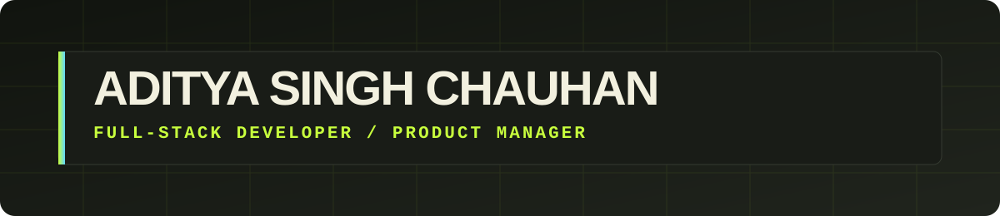

<div align="center">



<p>
  <a href="https://aditya16703.github.io/portfolio-site-aditya/"></a>
  <a href="https://github.com/Aditya16703"></a>
  <a href="https://www.linkedin.com/in/aditya-singh-chauhan-68a44230a/"></a>
</p>

<p>
  A game-inspired developer portfolio built as a single-file experience with a bold HUD visual system, responsive layouts, and subtle 3D motion.
</p>

</div>

## ⚡ About

I build scalable, high-performance web applications and help shape products from problem definition to delivery.

Currently in my final year of **B.Tech (CSE - AI & ML)**, I work across **React.js, Next.js, TypeScript, and the MERN stack**, combining engineering execution with product thinking.

## 🎮 Portfolio Highlights

- Game-inspired player-profile interface with a custom HUD visual language
- Responsive layout for desktop, tablet, and mobile screens
- Scroll-triggered reveal animations and pointer-based 3D card tilt
- Reduced-motion support for accessibility
- Live demo and source repository links for featured projects
- GitHub contribution activity and real profile links
- SEO metadata, Open Graph tags, favicon, and Person structured data
- Keyboard-visible focus states and mobile-friendly tap targets

## 🧩 Featured Missions

| Project | Description | Links |
| --- | --- | --- |
| **CredenceOS** | NBFC lending platform for underwriting, collections, repayments, and audit workflows. | [Live](https://credence-os.vercel.app) · [Code](https://github.com/Aditya16703/CredenceOS-) |
| **SmartTutorAI** | Agentic learning platform using hybrid RAG, live streaming, and AI-powered mastery. | [Live](https://smart-tutor-ai-tan.vercel.app) · [Code](https://github.com/Aditya16703/SmartTutorAI) |
| **GutBrain** | Personal knowledge system for saving, organizing, and sharing content from the web. | [Live](https://gutbrain.netlify.app) · [Code](https://github.com/Aditya16703/GutBrain) |
| **Annadata** | Role-based food donation platform connecting donors, food banks, and organizations. | [Live](https://fooddonationwebsiteannadata.netlify.app) · [Code](https://github.com/Aditya16703/Annadata-Food_Donation_Website) |
| **FlowDesk** | Project management application with workspaces, issue tracking, RBAC, and collaboration. | [Code](https://github.com/Aditya16703/EtharaAiAssignment) |

## 🛠️ Tech Stack

**Frontend:** React.js · Next.js · TypeScript · JavaScript · Tailwind CSS · Zustand · Framer Motion  
**Backend:** Node.js · Express.js · WebSockets · FastAPI · REST APIs · JWT  
**Data & Caching:** MongoDB · PostgreSQL · Redis · API integrations · Data modeling  
**Tools:** Docker · Git  
**Core CS:** DBMS · Operating Systems · Computer Networks · OOP · Data Structures & Algorithms

## 🚀 Run Locally

This portfolio intentionally uses no framework, server, or dependency.

```bash
git clone https://github.com/Aditya16703/portfolio-site-aditya.git
cd portfolio-site-aditya
```

Open `index.html` directly in a browser, or serve the folder with any static file server:

```bash
python -m http.server 5500
```

Then visit `http://localhost:5500`.

## 📁 Project Structure

```text
portfolio-site-aditya/
├── index.html    # Complete portfolio experience
└── README.md    # Project documentation
```

## 📬 Connect

- **GitHub:** [github.com/Aditya16703](https://github.com/Aditya16703)
- **LinkedIn:** [Aditya Singh Chauhan](https://www.linkedin.com/in/aditya-singh-chauhan-68a44230a/)
- **Email:** [ac3413452@gmail.com](mailto:ac3413452@gmail.com)

<div align="center">

<br>

**Open to Full-Stack Development and Product Management opportunities.**

<br><br>


</div>
